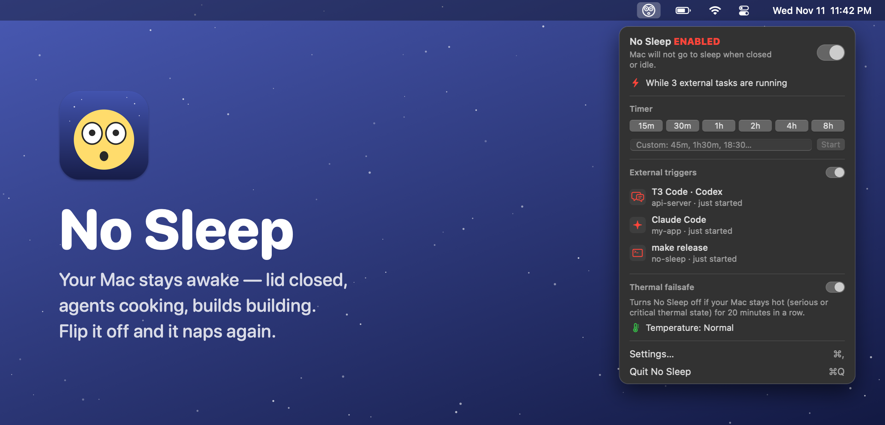
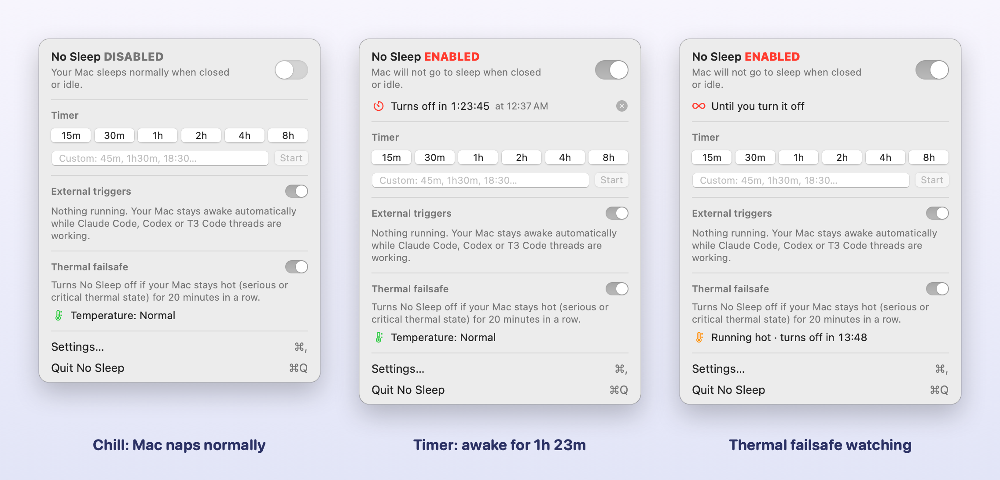

<p align="center">
  
</p>

<p align="center">
  <a href="https://github.com/pi-na/no-sleep/releases/latest"></a>
  
  
  <a href="LICENSE"></a>
</p>

**No Sleep** is a tiny native menu bar app that keeps your Mac awake, even with the lid closed, until you say otherwise. Flip the toggle, set a timer, or let your AI agents keep it up while they're working. The icon tells you what's going on: `z z z` means it can nap, 😳 means it's staying up.

It's 100% SwiftUI + AppKit with zero dependencies, and it's under 1 MB.

<p align="center"></p>

## What it does

- **One toggle.** `No Sleep ENABLED` = your Mac won't sleep when it's idle *or* when you close the lid (same trick as `sudo pmset disablesleep 1`, minus the typing).
- **Timers right in the menu.** 15m, 30m, 1h, 2h, 4h, 8h, or type whatever: `45m`, `1h30m`, `18:30`, `9am`.
- **Agent mode.** It stays awake while **Claude Code**, **Codex** or **T3 Code** threads are working, then goes back to normal when they're done, interrupted or crash.
- **Thermal failsafe.** If your Mac runs hot for 20 minutes straight, No Sleep switches itself off. That's what you want when it's closed in a backpack.
- **Low-battery guard.** It also lets your Mac sleep once the battery gets low (10% by default).
- **Plays nice.** Quitting always gives your Mac its normal sleep back.

## Installation - Releases

1. Grab the latest `.dmg` from **[Releases →](https://github.com/pi-na/no-sleep/releases/latest)** (Apple Silicon, macOS 27).
2. Open it and drag **No Sleep** into **Applications**.
3. It's not notarized (yet), so the first launch needs one of these:
   ```sh
   xattr -dr com.apple.quarantine /Applications/NoSleep.app
   ```
   …or open it once and hit **Open Anyway** in System Settings → Privacy & Security.

The first time you enable it, macOS asks for your password **once** so lid-closed mode works. That adds a sudoers rule that only allows `pmset -a disablesleep 0/1`, nothing else. You can revoke it any time from Settings.

On macOS 14–26 or an Intel Mac? [Build it from source](#build-from-source), it takes about a minute.

## Hook up your agents

Click **Settings → Agent integrations → Connect**, or run:

```sh
/Applications/NoSleep.app/Contents/Helpers/nosleep connect all   # claude | codex | all
```

That adds a few hooks to `~/.claude/settings.json` and `~/.codex/hooks.json` (your existing config stays untouched, and a backup is saved). T3 Code runs on top of both, so its threads are covered too. Codex asks you to approve new hooks the next time it starts.

## CLI

```sh
nosleep run -- make release      # stay awake while this runs
nosleep for 1h30m                # stay awake for a bit
nosleep acquire backup --pid 42  # stay awake until a process exits
nosleep list                     # who's keeping the Mac up?
```

You can install it into `~/.local/bin` from Settings.

## Build from source

You just need the Xcode Command Line Tools:

```sh
git clone https://github.com/pi-na/no-sleep && cd no-sleep
scripts/build-app.sh --install        # universal build → /Applications
scripts/package-dmg.sh 27.0 macos27   # Apple Silicon DMG for a given minimum macOS
```

## License

MIT. Do whatever, just keep the notice. See [LICENSE](LICENSE).
